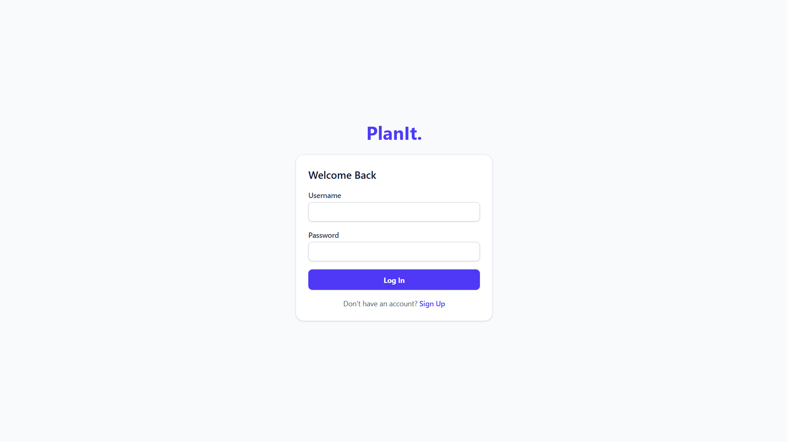
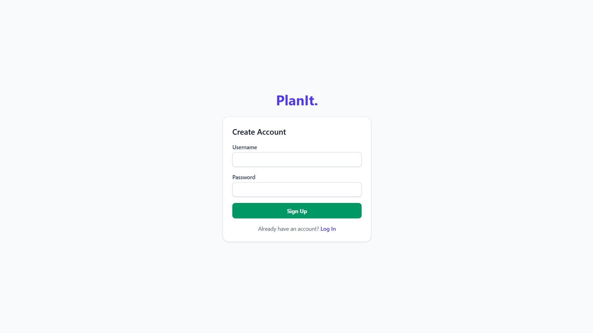
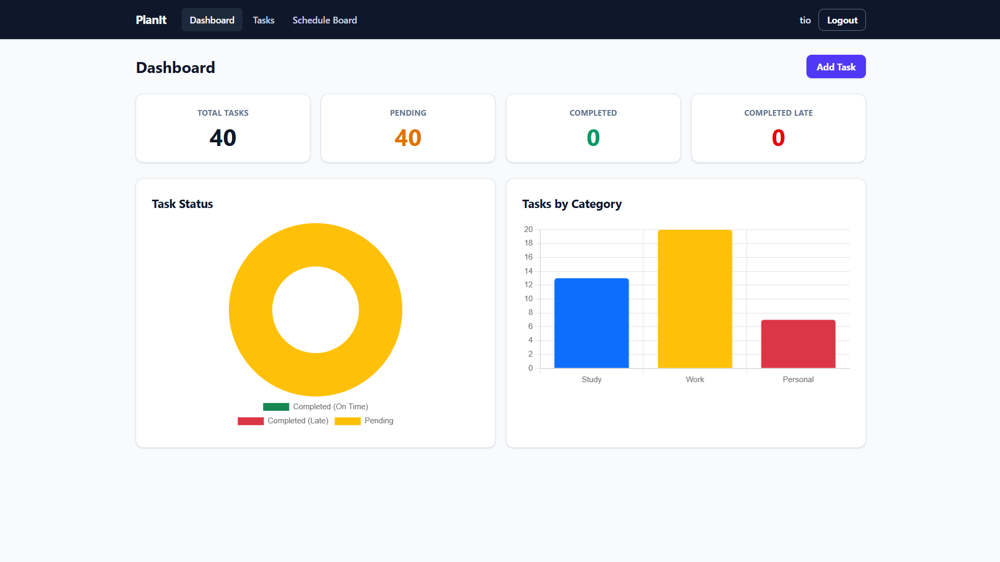
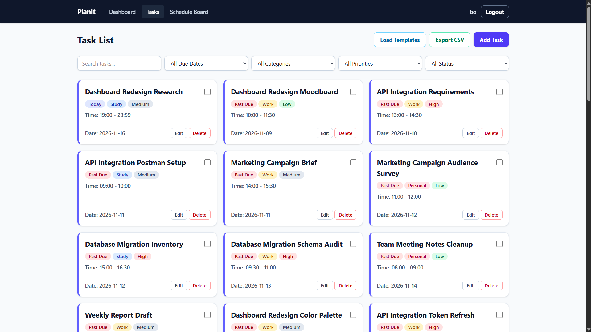
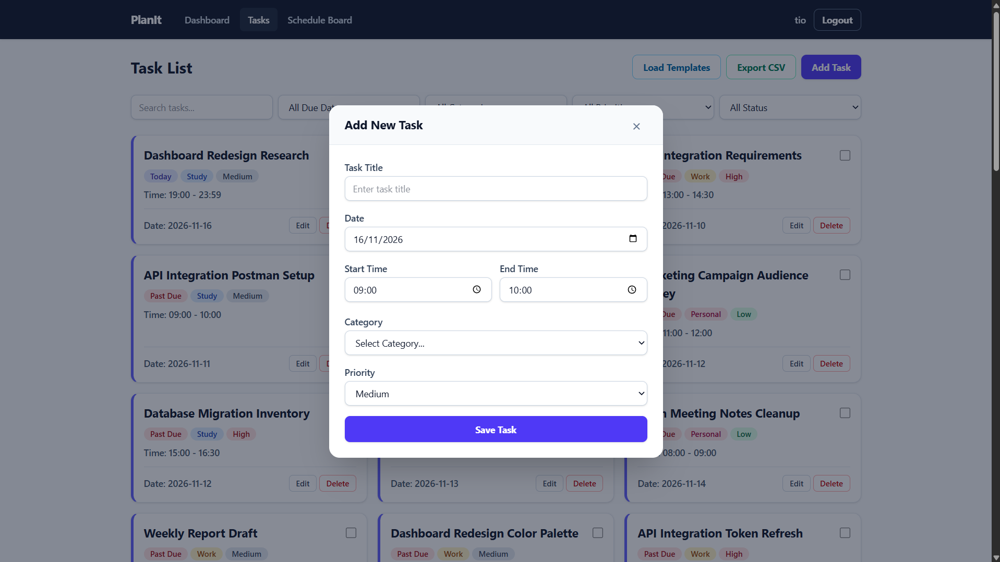
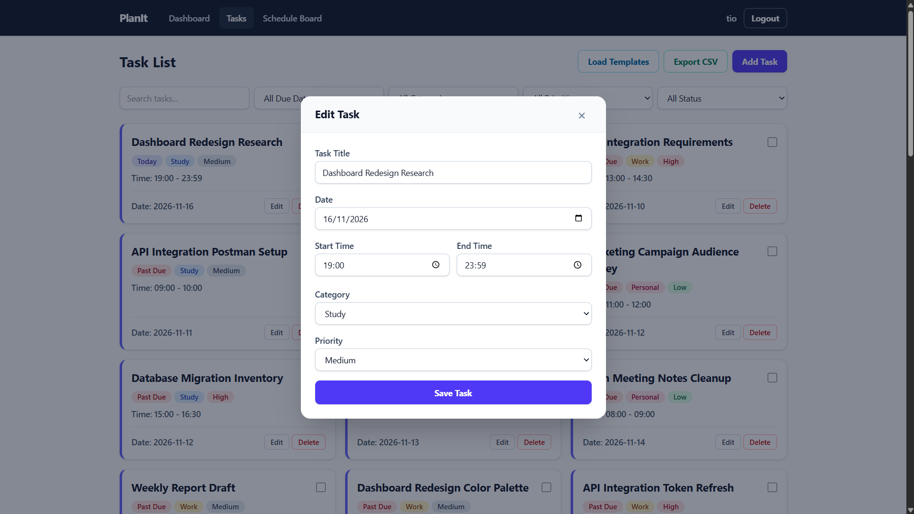
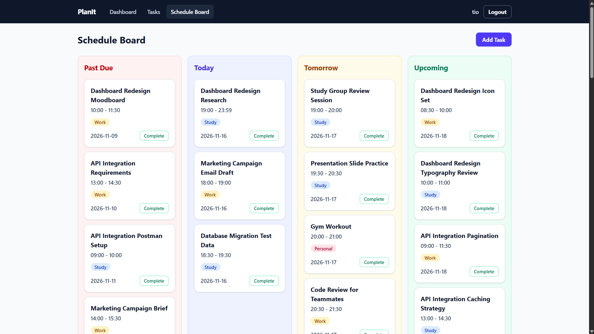

# PlanIt

Aplikasi perencana tugas dan jadwal berbasis web untuk mengatur kegiatan belajar, pekerjaan, dan urusan pribadi dalam satu tempat.

## Deskripsi

PlanIt membantu pengguna mencatat tugas, menentukan waktu pengerjaannya, dan memantau mana yang sudah selesai, mana yang akan jatuh tempo, dan mana yang terlambat. Setiap pengguna memiliki akun sendiri, sehingga daftar tugas antarpengguna tidak tercampur.

Aplikasi ini dibuat dengan HTML, JavaScript murni (tanpa framework), dan Tailwind CSS untuk tampilan. Data tugas dan akun disimpan di `localStorage` browser, sedangkan template tugas siap pakai disediakan oleh API sederhana dari `json-server`.

**Teknologi yang digunakan:**

- HTML5 dengan elemen semantik
- Tailwind CSS (v4, melalui CDN)
- JavaScript (vanilla)
- Chart.js untuk grafik di dashboard
- json-server untuk API template tugas

## Fitur

- **Registrasi dan login**: setiap pengguna punya akun dan daftar tugas sendiri. Halaman yang dilindungi akan mengarahkan pengguna yang belum login ke halaman login.
- **Kelola tugas (CRUD)**: tambah, ubah, tandai selesai, dan hapus tugas. Setiap tugas memiliki judul, tanggal, jam mulai, jam selesai, kategori, dan prioritas.
- **Validasi formulir**: judul, tanggal, dan kategori wajib diisi, tanggal tidak boleh di masa lalu, dan jam selesai harus setelah jam mulai.
- **Kategori dan prioritas**: kategori Study, Work, dan Personal, serta prioritas High, Medium, dan Low dengan label warna yang berbeda.
- **Status jatuh tempo otomatis**: setiap tugas diberi label Past Due, Today, Tomorrow, atau Upcoming berdasarkan tanggal dan jam selesainya.
- **Pencarian dan filter**: cari tugas berdasarkan judul, lalu saring berdasarkan jatuh tempo, kategori, prioritas, dan status (pending atau selesai).
- **Schedule Board**: tugas yang belum selesai dikelompokkan ke empat kolom, yaitu Past Due, Today, Tomorrow, dan Upcoming.
- **Dashboard**: ringkasan jumlah tugas (total, pending, selesai, selesai terlambat) beserta grafik status tugas dan grafik tugas per kategori.
- **Load Templates**: impor tugas contoh dari API `json-server` dengan satu klik.
- **Export CSV**: unduh semua tugas milik pengguna dalam format `.csv`.
- **Responsif dan mudah diakses**: tampilan menyesuaikan layar ponsel, menu navigasi dapat dibuka dan ditutup, dan struktur HTML semantik dengan label, `aria-current`, dan dialog bawaan browser.

## Cara Menjalankan

### Prasyarat

- [Node.js](https://nodejs.org/) (disarankan versi LTS)
- Koneksi internet, karena Tailwind CSS, Chart.js, dan skrip lainnya dimuat lewat CDN
- Ekstensi **Live Server** di VS Code, atau perintah `npx serve`, untuk menjalankan halaman web

### Langkah-langkah

1. **Masuk ke folder proyek**

   ```bash
   cd namafolder
   ```

2. **Pasang dependensi**

   ```bash
   npm install
   ```

3. **Jalankan API template** (diperlukan hanya untuk tombol *Load Templates*)

   ```bash
   npm run api
   ```

   API akan berjalan di `http://localhost:3000`. Biarkan terminal ini tetap terbuka.

4. **Jalankan halaman web** di terminal atau jendela lain, pilih salah satu cara:

   - Klik kanan `index.html` di VS Code, lalu pilih **Open with Live Server**, atau
   - Jalankan:

     ```bash
     npx serve
     ```

     lalu buka alamat yang tampil di terminal.

   - Bisa juga akses cd folderproject lalu jalankan

      ```bash
      python -m http.server
      ```

5. **Buka aplikasi**, daftar akun baru lewat halaman *Sign Up*, lalu mulai menambahkan tugas.

### Struktur Folder

```
planit/
├── index.html        # mengarahkan ke pages/login.html
├── db.json           # data template untuk json-server
├── package.json
├── pages/
│   ├── login.html
│   ├── register.html
│   ├── dashboard.html
│   ├── tasks.html
│   └── board.html
└── js/
    ├── auth.js       # login, registrasi, dan sesi
    ├── storage.js    # penyimpanan localStorage
    ├── utils.js      # fungsi bantu dan warna label
    ├── notifications.js
    ├── due-status.js
    ├── task-validation.js
    ├── task-modal.js
    ├── task-crud.js
    ├── render-tasks.js
    ├── render-board.js
    ├── render-dashboard.js
    ├── export-csv.js
    ├── templates.js
    ├── layout.js
    └── main.js       # titik awal, harus dimuat paling akhir
```

### Catatan

- Data akun dan tugas tersimpan di `localStorage` browser, jadi hanya ada di browser dan perangkat yang dipakai. Menghapus data situs akan menghapus semuanya.
- Kata sandi disimpan apa adanya di `localStorage`. Aplikasi ini ditujukan untuk pembelajaran dan tidak aman untuk data sungguhan.
- Jika tombol *Load Templates* menampilkan peringatan, pastikan `npm run api` sedang berjalan.

## Screenshot

### Halaman Login



### Halaman Registrasi



### Dashboard



### Daftar Tugas



### Form Tambah Tugas



### Form Edit Tugas



### Schedule Board

